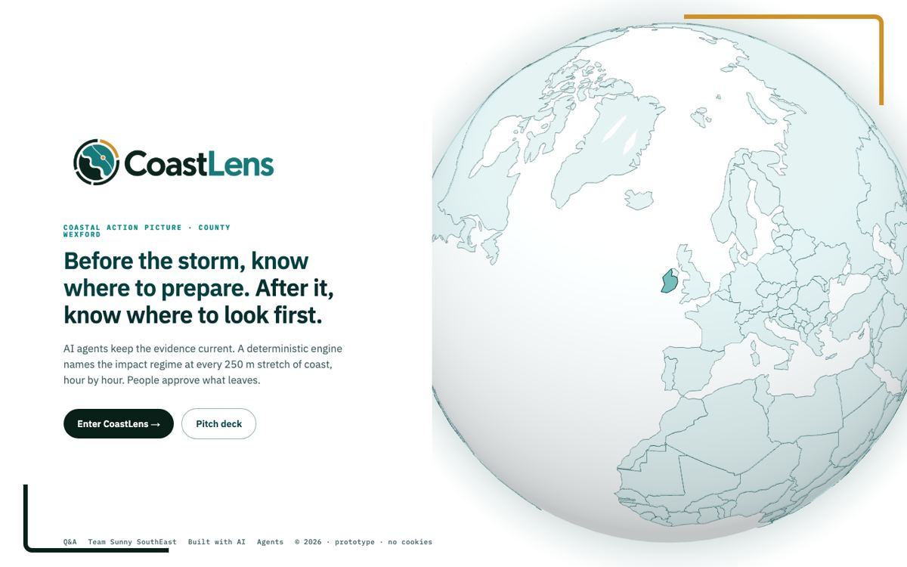

# CoastLens

**Before a storm, a council knows the weather. It does not know which stretch of its own coast needs attention first. CoastLens answers that, 250 metres at a time.**

## Why I built it

My entry into the TechIreland National AI Challenge 2026, with teammates Eddie Heffernan and Eduard Dreyer (Team Sunny SouthEast). Wexford's coast takes a beating most winters. Councils get broad weather and marine warnings, then have to decide where a handful of crews go first. The evidence to answer that exists, but it is scattered across agencies, formats and decades. We set out to show that AI agents can gather it, and that a council can still trust the answer, because the AI never touches the physics.

## What's under the hood

- **250 m coastal stretches.** The County Wexford coast is split into short stretches, each with its own baseline, so an alert points at a place a crew can drive to.
- **A deterministic engine owns the physics.** Published coastal equations (Stockdon wave runup, the Sallenger storm-impact scale) name the likely impact on each stretch, hour by hour: swash, collision, overwash or inundation.
- **The language model never does the maths.** It cannot compute, change or retype a number. It writes the briefing from a locked set of values the engine hands it.
- **AI agents keep the evidence current.** They work through agency reports, survey data and storm records, and turn them into a source register the engine can cite.
- **Measured versus modelled, on every value.** Observations and modelled proxies are labelled differently. When the evidence does not pass the gate, the engine returns no result rather than a guess.
- **A person approves what leaves.** Outputs are operational, such as where to inspect first. Never engineering advice.
- **Storm Kathleen is the benchmark.** A real event from April 2024 that the method can be checked against and proven wrong. The Kathleen scenario is labelled provisional and is not field validated.

## Where it stands

A working prototype, and it says so. Live at [coastlens.ie](https://coastlens.ie).

Source: private.

---

Team Sunny SouthEast: Eddie Heffernan, Eduard Dreyer and John Robinson
